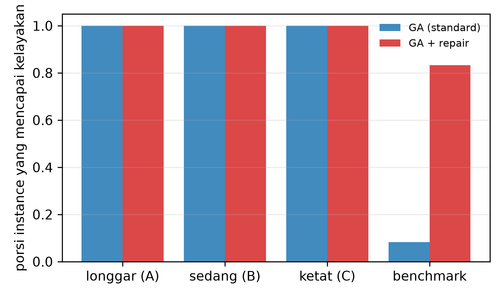
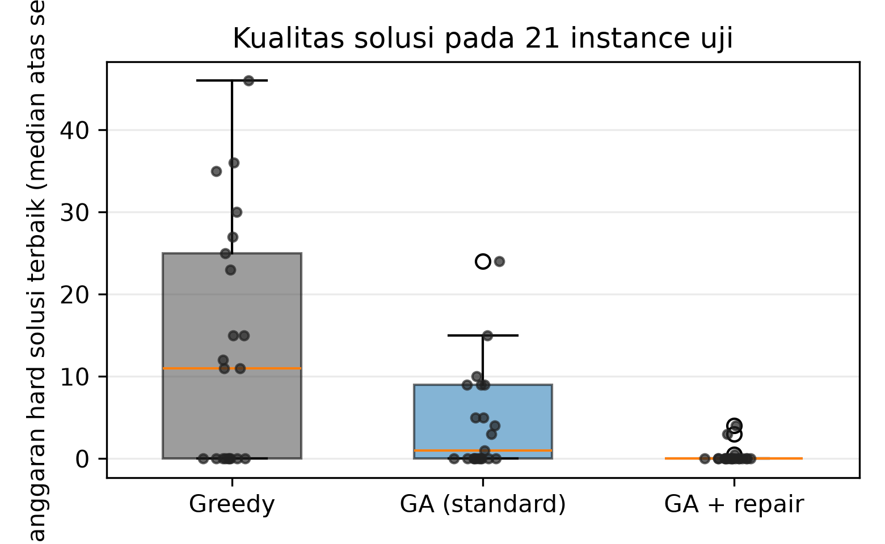
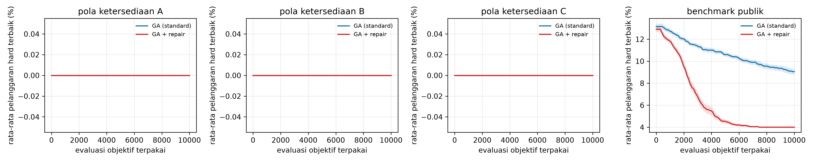
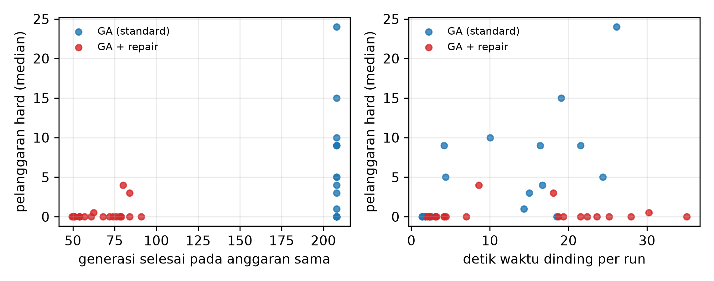
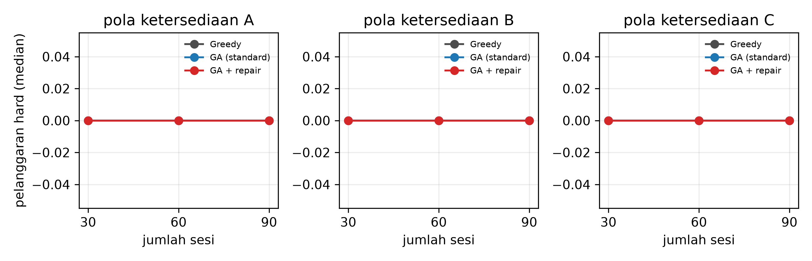

# Algoritma Genetika Berbasis Repair untuk Penjadwalan Mata Kuliah di Bawah Kendala Ketersediaan Dosen

Slamet Riyadi (F5522630001), Muhammad Adi Agum (F5522630002), Akbar Tri Wicaksono (F5522630003), I Ketut Divta Suryawan (F5522630004)

Program Studi Teknologi Informasi (S2), Program Pascasarjana — Kecerdasan Komputasional, 2026

## Abstrak

Penjadwalan mata kuliah harus memenuhi ketersediaan dosen, pemakaian ruang, konflik kelompok mahasiswa, dan kapasitas ruang secara bersamaan; ketika ketersediaan dosen mengetat, jadwal yang dibangkitkan secara acak hampir selalu tidak layak, sehingga algoritma genetika (GA) berpotensi menghabiskan sebagian besar pencariannya pada wilayah yang tidak layak. Penelitian ini mengajukan pertanyaan yang terkendali: pada anggaran evaluasi objektif yang identik, apakah perbaikan pelanggaran kendala wajib setelah crossover dan mutasi membuat GA lebih sering menemukan jadwal layak, dan berapa biaya perbaikan tersebut? Kami membandingkan tiga metode — konstruksi greedy deterministik, GA standar, dan GA yang sama dengan tambahan operator repair yang memindahkan sesi yang melanggar ke pasangan ruang–slot valid dengan penambahan penalti preferensi terkecil — pada sembilan instance sintetis (30, 60, dan 90 sesi; tiga pola ketersediaan dosen) yang layak secara konstruksi, serta pada dua belas instance benchmark kurikulum ITC2007 yang publik. Setiap evaluasi objektif dibebankan pada anggaran bersama sebesar 10.000 evaluasi per run, termasuk setiap kandidat yang diperiksa oleh repair, dan 20 seed dipakai untuk setiap metode stokastik pada setiap instance. Repair menaikkan porsi instance yang terselesaikan hingga layak dari {{ga_std_feas_inst}}/{{n_inst}} (GA standar) menjadi {{ga_repair_feas_inst}}/{{n_inst}} (GA dengan repair) dan menurunkan median jumlah pelanggaran hard dari {{med_H_std}} menjadi {{med_H_repair}}, dengan harga {{repair_share}} anggaran evaluasi dan {{gens_ratio}}× lebih sedikit generasi yang selesai. Keunggulan tersebut terkonsentrasi pada instance benchmark publik, tempat okupansi ruang tinggi dan konstruktor deterministik tidak pernah mencapai kelayakan; pada tangga ketersediaan terkendali, ketika semua metode sudah menemukan jadwal layak, repair justru menurunkan penalti preferensi dan tidak mengubah kelayakan. Hasil ini memberikan catatan yang ternormalisasi anggaran dan dapat direproduksi tentang kapan perbaikan kendala bermanfaat dalam penjadwalan mata kuliah dan kapan perbaikan tersebut hanya mengonsumsi kapasitas pencarian.

**Kata kunci:** penjadwalan mata kuliah; algoritma genetika; perbaikan kendala; anggaran evaluasi; ketersediaan dosen; kelayakan

## 1. Pendahuluan

Penjadwalan mata kuliah universitas menempatkan setiap sesi kelas wajib ke sebuah ruang dan slot waktu sehingga tidak ada dosen, kelompok mahasiswa, atau ruang yang dipakai dua kali pada slot yang sama, kapasitas ruang terpenuhi, dan dosen tidak dijadwalkan pada waktu ketika mereka tidak tersedia. Masalah ini NP-hard secara umum, dan instance praktis menggabungkan ratusan sesi dengan kalender dosen yang sangat terbatas. Metode berbasis pencarian — local search, tabu search, simulated annealing, matheuristik, dan algoritma evolusioner — karenanya menjadi perangkat standar, dan jalur curriculum-based course timetabling (CB-CTT) pada International Timetabling Competition kedua (ITC2007) masih menjadi keluarga benchmark acuan (Bettinelli et al., 2015; Müller, 2009; Di Gaspero & Schaerf, 2003; Geiger, 2010).

Algoritma genetika menarik untuk penjadwalan karena jadwal dapat dikodekan langsung sebagai satu pasangan ruang–slot per sesi, dan crossover serta mutasi dapat merekombinasi penugasan parsial. Pengodean yang sama, bagaimanapun, membuat keturunan rapuh: crossover seragam antara dua induk yang layak umumnya menghasilkan anak yang melanggar banyak kendala wajib, karena gen yang diwarisi dari induk berbeda saling berebut dosen, kelompok, dan ruang yang sama. GA tanpa penanganan kendala karenanya menghabiskan anggarannya untuk menilai jadwal yang tidak layak. Dua keluarga solusi lazim dalam literatur evolusioner: fungsi penalti yang mempertahankan solusi tidak layak dalam populasi tetapi memberi peringkat dengan suku penalti, dan operator repair yang mengubah kandidat tidak layak menjadi layak (atau kurang tidak layak) sebelum evaluasi (Coello Coello, 2002). Algoritma evolusioner berkendala yang terbaru tetap memakai pembenihan yang sadar struktur dan repair berbasis proyeksi ketika wilayah layak sempit (Zhang et al., 2026; Rao & Jia, 2026; Zhao et al., 2026).

Repair tidak gratis. Setiap kandidat perpindahan yang diperiksa operator adalah satu evaluasi objektif yang seharusnya dapat dipakai algoritma untuk seleksi dan variasi. Kajian metaheuristik untuk penjadwalan pendidikan biasanya melaporkan batas waktu atau jumlah iterasi, sedangkan makalah penanganan kendala biasanya melaporkan kualitas solusi terhadap jumlah generasi tetap; tidak ada satu pun konvensi yang membuat biaya penanganan kendala eksplisit. Akibatnya pertanyaan praktis sulit dijawab: jika jumlah evaluasi objektif ditetapkan, apakah repair memperbaiki kualitas dan kelayakan jadwal yang ditemukan, atau justru menghabiskan anggaran yang seharusnya menghasilkan pencarian lebih baik?

Makalah ini menjawab pertanyaan tersebut untuk konteks spesifik yang diminta pada tugas mata kuliah kami: GA dengan repair untuk penjadwalan mata kuliah di bawah kendala ketersediaan dosen. Kontribusi kami sengaja sempit dan empiris, bukan arsitektural. Kami (i) mengimplementasikan GA yang satu gennya berupa pasangan ruang–slot dengan tujuan leksikografis — pelanggaran hard lebih dulu, penalti preferensi sesudahnya; (ii) menambahkan operator repair yang memindahkan sesi yang terlibat pelanggaran hard ke pasangan ruang–slot valid dengan penambahan penalti preferensi terkecil, sekaligus mencatat kegagalan ketika tidak ada perpindahan valid; (iii) membandingkan konstruksi greedy, GA standar, dan GA berbasis repair pada anggaran yang identik sebesar 10.000 evaluasi objektif, dengan setiap kandidat repair dibebankan pada anggaran tersebut; dan (iv) menganalisis trade-off kualitas–biaya yang dihasilkan pada tiga pola ketersediaan dosen dan tiga ukuran instance, ditambah dua belas instance benchmark publik. Kami juga melaporkan ablation yang memvariasikan intensitas repair dan ablation yang mematikan pembenihan greedy, serta menguji konfigurasi yang sama dengan batas percobaan repair lebih tinggi.

Makalah ini disusun sebagai berikut. Bagian 2 mengulas literatur terdekat. Bagian 3 memformulasikan masalah, fungsi tujuan, dan aturan akuntansi evaluasi. Bagian 4 menjelaskan ketiga metode dan desain eksperimen, termasuk pilot yang dipakai untuk mengunci parameter sebelum instance uji dievaluasi. Bagian 5 melaporkan hasil, Bagian 6 mendiskusikannya terhadap pertanyaan diskusi wajib, Bagian 7 menyatakan ancaman terhadap validitas, dan Bagian 8 menyimpulkan.

## 2. Kajian terkait

**Benchmark penjadwalan dan local search.** Formulasi CB-CTT yang dipakai di sini mengikuti jalur ITC2007, yang instance-nya masih dipakai untuk mengevaluasi metode pencarian baru; Bettinelli et al. (2015) menyurvei formulasi, model, dan algoritma untuk masalah ini, dan Müller (2009) menjelaskan pendekatan hibrida pemenang kompetisi tersebut. Keluarga local search tetap kuat: Di Gaspero dan Schaerf (2003) memperkenalkan local search multi-lingkungan untuk penjadwalan mata kuliah, Geiger (2010) menerapkan threshold accepting, dan sebuah studi terbaru meninjau kembali desain local search untuk CB-CTT serta mengamati bahwa membangun metode pencarian yang bekerja pada dataset beragam di bawah batas waktu masih menantang (Ceschia et al., 2026). Pendekatan variable neighbourhood descent tahun 2026 menggabungkan inisialisasi CP-SAT dengan perpindahan rantai Kempe dan penalti adaptif untuk keluarga benchmark yang sama (Nguyen, 2026). Metode-metode ini mencapai solusi berkualitas tinggi tetapi bertolak dari, atau secara eksplisit membangun, jadwal yang layak; fokus kami adalah perilaku GA ketika kelayakan tidak dijamin dan anggaran evaluasi kecil serta tetap.

**Metaheuristik untuk penjadwalan pendidikan.** Tinjauan metaheuristik untuk penjadwalan mata kuliah universitas menunjukkan dominasi desain hibrida dan berbasis populasi (Abdipoor et al., 2023), dan karya terbaru menggabungkan strategi eksplorasi serta eksploitasi untuk kelas masalah yang sama (Badoni et al., 2023). Algoritma genetika tetap menjadi pilihan umum: Romaguera et al. (2024) memakai mutasi heuristik yang memusatkan perhatian pada gen yang tidak layak, Li dan Gonsalves (2022) merancang varian GA untuk kasus penjadwalan ujian di Jepang, sedangkan pendekatan simulated annealing dan matheuristik menangani kendala administratif yang lebih kaya seperti program ganda, kurikulum bertingkat, dan preferensi multikriteria (Erdoğan Akbulut et al., 2024; Steiner et al., 2024; Dunke & Nickel, 2023). Iterated local search telah berhasil diterapkan pada penjadwalan olahraga dengan kendali parameter adaptif (Premananda et al., 2024; Muklason & Premananda, 2026), dan hyper-heuristic dipakai untuk penjadwalan ujian (Muklason et al., 2024). Yang sama pada studi-studi tersebut adalah usaha komputasi untuk penanganan kendala tidak dipisahkan dari usaha pencarian dalam perbandingan yang dilaporkan.

**Penanganan kendala dan repair.** Survei klasik Coello Coello (2002) mengklasifikasikan teknik penanganan kendala untuk algoritma evolusioner menjadi fungsi penalti, representasi dan operator khusus, algoritma repair, serta pemisahan tujuan dan kendala. Repair menarik ketika solusi layak harus dihasilkan, tetapi ia memunculkan biaya tersembunyi, karena setiap percobaan repair mengevaluasi modifikasi kandidat. Karya terbaru melaporkan penanganan kendala berbasis komparator (Takami & Obayashi, 2022), penanganan kendala multitipe untuk masalah multiobjektif (Rao & Jia, 2026), repair berbasis proyeksi dengan pembenihan sadar struktur (Zhang et al., 2026), serta pencarian berbantuan surrogate yang sadar anggaran dan dipandu kelayakan (Zhao et al., 2026). Desain sadar anggaran juga dikaji untuk optimasi multiobjektif berbantuan surrogate di bawah anggaran komputasi terbatas (Wang et al., 2025) dan untuk pemilihan algoritma serta penyetelan parameter ketika usaha evaluasi merupakan sumber daya (Mahpour & El-Diraby, 2024). Konfigurasi algoritma otomatis, yang dicontohkan oleh irace, membuat biaya pencarian parameter menjadi eksplisit (López-Ibáñez et al., 2016), dan studi perbandingan metaheuristik berulang kali menunjukkan bahwa peringkat bergantung pada bagaimana anggaran komputasi dialokasikan (Kaya, 2022). Studi kami mengikuti jalur ini: repair dibebankan pada anggaran dan trade-off dilaporkan secara eksplisit untuk sebuah GA penjadwalan.

**Posisi penelitian.** Dibandingkan dengan studi di atas, kontribusi kami bukan lingkungan pencarian (neighbourhood) baru atau kerangka evolusioner baru, dan kami tidak mengklaim bahwa repair itu sendiri baru. Kontribusinya adalah pengukuran terkendali dan ternormalisasi anggaran tentang kapan repair bermanfaat bagi penjadwalan mata kuliah di bawah ketersediaan dosen yang mengetat, dengan desain yang dikunci sebelum instance uji dievaluasi dan dengan seluruh rekaman mentah per run dirilis.

## 3. Formulasi masalah dan akuntansi evaluasi

### 3.1 Instance

Sebuah instance terdiri atas sesi, dosen, kelompok mahasiswa, ruang, hari, dan periode. Setiap sesi *i* memiliki satu dosen, sekumpulan kelompok mahasiswa, sejumlah mahasiswa, dan sekumpulan slot terlarang yang diturunkan dari ketersediaan dosen. Jadwal menugaskan setiap sesi ke ruang *r(i)* dan slot *s(i)*; satu sesi menempati tepat satu slot dengan durasi tetap. Ruang memiliki kapasitas, dan sebuah ruang paling banyak menampung satu sesi per slot.

### 3.2 Kendala wajib dan penalti preferensi

Kendala wajib adalah: (H1) seorang dosen mengajar paling banyak satu sesi per slot; (H2) sebuah ruang menampung paling banyak satu sesi per slot; (H3) sebuah kelompok mahasiswa menghadiri paling banyak satu sesi per slot; (H4) ruang yang ditugaskan harus kompatibel dengan sesi dan kapasitasnya harus memadai; dan (H5) sesi tidak boleh ditempatkan pada slot terlarang. Untuk setiap jenis kendala, jumlah pelanggaran adalah kelebihan terhadap kapasitas (slot dengan *c* sesi dari dosen yang sama menyumbang *c* − 1), sehingga total *H* bersifat aditif antartipe kendala.

Penalti preferensi *P* adalah jumlah periode kosong antara kelas pertama dan kelas terakhir suatu kelompok mahasiswa pada hari tertentu, dijumlahkan atas seluruh kelompok dan hari. Jadwal dibandingkan secara leksikografis: minimalkan *H* lebih dulu, lalu *P*. Jadwal disebut *layak* ketika *H* = 0; hanya jadwal layak yang dibandingkan pada *P*, dan run yang tidak pernah mencapai kelayakan dilaporkan sebagai kegagalan, bukan dirata-ratakan sebagai keberhasilan.

### 3.3 Akuntansi evaluasi

Satu evaluasi adalah satu penilaian objektif atas satu kandidat: entah penilaian lengkap sebuah jadwal, atau satu kandidat perpindahan yang diperiksa operator repair. Seluruh penilaian yang dilakukan algoritma dibebankan, termasuk inisialisasi populasi dan setiap kandidat repair; pembangunan indeks okupansi merupakan pembukuan, bukan penilaian objektif, sehingga tidak dibebankan, meskipun biayanya terlihat pada waktu dinding yang dilaporkan. Setiap metode stokastik berhenti tepat pada {{budget}} evaluasi per run. Baseline greedy deterministik dilaporkan dengan jumlah penilaian pasangan yang benar-benar dilakukannya dan tidak dipotong, karena tidak memiliki titik henti yang sebanding.
## 4. Metode dan desain eksperimen

### 4.1 Pengodean dan operator

Satu kromosom adalah pasangan larik bilangan bulat: ruang dan slot untuk setiap sesi. Inisialisasi memakai benih greedy: individu ke-0 dihasilkan oleh konstruksi greedy deterministik yang mendahulukan sesi paling terkendala (ketersediaan dosen paling ketat lebih dulu, lalu ruang kompatibel paling sedikit), dan individu lainnya dihasilkan oleh aturan greedy yang sama dengan urutan sesi dan pemecahan seri yang diacak. Seleksi adalah seleksi turnamen dengan *k* = 3, crossover bersifat seragam per gen dengan peluang {{pc}}, mutasi mengubah, untuk setiap gen secara independen, slot, ruang, atau keduanya, dengan peluang per gen {{pm_desc}}, dan dua elit disalin tanpa perubahan ke generasi berikutnya.

### 4.2 Operator repair

Setelah variasi dan sebelum evaluasi, operator repair memeriksa keturunan, mengumpulkan sesi yang terlibat sedikitnya satu pelanggaran hard, mengacak urutannya, dan untuk paling banyak {{k_repair}} sesi tersebut mengeluarkan sesi dari indeks okupansi, menghitung slot yang kosong bagi dosennya, kosong bagi semua kelompok mahasiswanya, diizinkan ketersediaannya, serta memiliki paling sedikit satu ruang kompatibel yang kosong, mengambil sampel hingga {{repair_attempts}} slot kandidat tersebut, dan memindahkan sesi ke kandidat dengan penambahan penalti preferensi terkecil (seri diselesaikan dengan ruang berkapasitas paling pas). Ketika tidak ada slot valid, perpindahan gagal dan kegagalan dihitung; run berlanjut. Setiap kandidat yang diperiksa dibebankan sebagai satu evaluasi. Repair tidak pernah menciptakan pelanggaran hard baru, karena slot kandidat valid secara konstruksi, sehingga perpindahan yang berhasil secara ketat menurunkan jumlah pelanggaran yang dapat diatribusikan pada sesi yang diperbaiki.

### 4.3 Instance

{{TABLE:instances}}

Sembilan instance sintetis dibangkitkan untuk studi ini (30, 60, dan 90 sesi; tiga pola ketersediaan dosen) bersama dua instance pilot terpisah. Setiap instance sintetis dibangun dari jadwal yang diketahui layak: jadwal basis dibuat lebih dulu, lalu ketersediaan dosen dipersempit dengan menjaga jadwal basis tetap valid. Pola A mempertahankan 60% slot tersedia bagi setiap dosen, pola B mempertahankan 30%, dan pola C mempertahankan 10%, sehingga kelayakan terjamin tetapi menjadi makin sulit ditemukan kembali. Generator, seed-nya, dan jadwal basis dirilis bersama kode, dan kelayakan setiap jadwal basis diverifikasi ulang oleh validator independen.

Dua belas instance publik (comp01–comp12) dari benchmark ITC2007 CB-CTT dipakai sebagai komponen data nyata, tanpa modifikasi; situs kompetisi asli tidak lagi menyediakan berkas secara langsung, sehingga dipakai salinan yang dimirror luas pada repositori data `itc2007-cct`, dan lisensi serta atribusinya didokumentasikan pada README yang dirilis. Tidak tersedia jadwal institusi nyata yang teranonimkan bagi kelompok kami, sehingga benchmark publik ditambah simulasi terkendali menjadi cakupan studi ini, sebagaimana diizinkan oleh brief.

### 4.4 Desain terkunci dan pilot

Desain dikunci sebelum instance uji dievaluasi: pertanyaan riset, hipotesis, pembagian instance (2 instance pilot dan 2 instance benchmark untuk pengembangan; 9 instance sintetis dan 12 instance benchmark untuk uji), anggaran, seed, metrik, uji statistik, dan aturan berhenti dicatat dalam dokumen design lock. Parameter hanya dipilih pada instance pengembangan, dari grid yang didaftarkan lebih dulu: peluang mutasi per gen pada {1/*n*, 0.02, 0.05}; jumlah sesi yang diperbaiki per keturunan pada {1, 3, 5}; percobaan repair per sesi pada {1, 2}; dan apakah fallback repair berbasis swap diaktifkan. Aturan seleksi deterministiknya adalah: proporsi run layak tertinggi, lalu median *H* terendah, lalu median *P* terendah, lalu porsi anggaran untuk repair terendah. Pilot terdiri atas {{pilot_runs}} run pada 36 konfigurasi repair ditambah sapuan peluang mutasi untuk GA standar dan baseline greedy.

Konfigurasi terpilih adalah {{locked_cfg}}. Pada pilot, konfigurasi tersebut mencapai kelayakan pada {{pilot_feas_repair}} dari {{pilot_runs_repair}} run dengan median *H* = {{pilot_H_repair}} dan median *P* = {{pilot_P_repair}}, sedangkan GA standar dengan setelan mutasi yang sama mencapai kelayakan pada {{pilot_feas_std}} dari {{pilot_runs_std}} run dengan median *H* = {{pilot_H_std}}. Konfigurasi yang sama kemudian diterapkan tanpa perubahan pada seluruh instance uji, dan 20 seed dipakai untuk setiap metode stokastik pada setiap instance.

### 4.5 Metrik, validasi, dan statistik

Metrik primer adalah jumlah pelanggaran hard dari jadwal terbaik yang ditemukan dalam anggaran, proporsi run yang mencapai kelayakan, dan jumlah evaluasi terpakai ketika jadwal layak pertama ditemukan (dilaporkan sebagai tidak tercapai bila anggaran berakhir lebih dulu). Metrik sekunder adalah penalti preferensi jadwal terbaik, waktu dinding, jumlah generasi yang selesai, jumlah percobaan repair, perpindahan, dan kegagalan, serta porsi anggaran untuk repair. Setiap jadwal terbaik diperiksa ulang oleh validator independen yang tidak berbagi kode dengan fungsi penilaian; run yang jumlah tervalidasinya berbeda dari jumlah hasil penilaian dicatat sebagai kegagalan.

Perbandingan dilakukan berpasangan per instance. Untuk setiap instance dan metode, median dari 20 seed mewakili metode tersebut, karena seed pada instance yang sama bukan sampel independen. GA standar dan GA berbasis repair dibandingkan dengan uji Wilcoxon signed-rank atas {{n_inst}} instance uji; ketiga metode dibandingkan dengan uji Friedman yang dilanjutkan uji post-hoc berpasangan dengan koreksi Holm; Cliff's delta dilaporkan sebagai ukuran efek. Proporsi kelayakan dibandingkan dengan uji McNemar eksak atas instance. Seluruh analisis dipisahkan menurut pola ketersediaan dosen dan menurut keluarga instance.

## 5. Hasil

Seluruh angka pada bagian ini dihitung dari 861 rekaman run pada `03_experiments/raw/main.jsonl`; tabel turunannya berada di `04_results/tables/` dan lembar angka di `05_manuscript/numbers_main.md`. Tidak ada run yang gagal validasi, dan setiap run mencapai anggaran evaluasinya atau titik henti alaminya.

### 5.1 Kelayakan dan kualitas pada seluruh instance uji

{{TABLE:main_performance}}

Pada 21 instance uji, GA berbasis repair mencapai jadwal terbaik yang layak pada mayoritas seed-nya di 19 instance, dibandingkan 10 untuk GA standar dan 9 untuk konstruksi greedy deterministik (Gambar 1); sebaran penuh median per instance ditunjukkan pada Gambar 2. Median pelanggaran hard berturut-turut 0, 1, dan 11, sedangkan median penalti preferensi 63, 95, dan 38. Perbandingan berpasangan atas instance tidak ambigu: uji Wilcoxon signed-rank atas median jumlah pelanggaran hard per instance memberikan *W* = 0, *p* = 0.0033, Cliff's delta = −1.00, yang berarti GA berbasis repair lebih baik pada setiap satu dari 21 instance; untuk penalti preferensi hasilnya sama arahnya dan sedikit lebih kuat signifikansinya (*W* = 0, *p* = 0.0003, delta = −1.00). Uji Friedman atas ketiga metode menolak kesetaraan untuk kedua metrik (*χ*² = 23.53, *p* < 0.001 untuk *H*; *χ*² = 10.47, *p* = 0.0053 untuk *P*), dan ketiga perbandingan post-hoc terkoreksi Holm tetap signifikan pada *p* ≤ 0.0066.

{{TABLE:main_stats}}

Kelayakan adalah luaran biner per instance, sehingga diuji secara terpisah. Pada sembilan instance tempat kedua GA berbeda hasil, GA berbasis repair layak pada mayoritas seed sedangkan GA standar tidak layak di kesembilan instance tersebut; uji McNemar eksak memberikan *p* = 0.0039 tanpa instance yang berbeda arah. Efeknya karenanya bukan pergeseran kecil pada kualitas rata-rata, melainkan perubahan pada apakah pencarian menghasilkan jadwal yang dapat dipakai atau tidak.

### 5.2 Dari mana keunggulan berasal: tangga sintetis versus benchmark publik

{{TABLE:main_by_pattern}}

Kedua keluarga instance berperilaku sangat berbeda, dan perbedaan inilah hasil paling informatif dari studi ini.

Pada sembilan instance sintetis, setiap metode menghasilkan jadwal layak pada setiap seed, termasuk konstruksi greedy deterministik. Ketersediaan dimanipulasi dari 67% slot per dosen (pola A) menjadi 43% (pola B) dan 23% (pola C), tetapi karena setiap instance sintetis dibangun dari jadwal basis yang diketahui layak dan okupansi ruang hanya separuh kapasitas, instance tidak pernah cukup sulit sehingga kelayakan dapat memisahkan metode. Meskipun demikian, GA berbasis repair mempertahankan keunggulan pada tujuan sekunder: median penalti preferensi pada pola A, B, dan C adalah 0.00, 0.00, dan 0.00, dibandingkan 0.00, 2.00, dan 4.50 untuk GA standar serta 23.0, 24.0, dan 17.0 untuk konstruksi greedy. Dengan kata lain, ketika kelayakan mudah, repair bermanfaat pada kualitas solusi, bukan pada kelayakan.

Pada dua belas instance benchmark publik gambaran berbalik. Konstruksi greedy tidak pernah mencapai kelayakan (median *H* = 24), GA standar mencapainya hanya pada 17 dari 240 run (satu instance dengan mayoritas seed layak), dan GA berbasis repair mencapainya pada 173 dari 240 run (sepuluh instance dengan mayoritas seed layak), dengan median *H* = 0 dan median *P* = 106.5 dibandingkan 7 dan 171 untuk GA standar. Instance benchmark memiliki okupansi ruang antara 0.47 dan 0.89 serta beberapa ratus sesi, sehingga wilayah layak sempit dan keturunan hasil crossover seragam hampir selalu tidak layak; repair-lah yang mengembalikannya. Perlu dicatat, ketersediaan dosen pada instance benchmark justru *lebih longgar* daripada pola sintetis terketat kami (ketersediaan rata-rata 0.57–0.94 dibandingkan 0.23 untuk pola C), yang memperkuat kesimpulan: yang membuat instance ini sulit adalah interaksi antara ketersediaan yang terbatas dan kapasitas ruang yang hampir penuh, bukan ketersediaan semata.

Dua instance menolak semua metode: comp01 (median *H* terbaik = 4 untuk GA berbasis repair, 9 untuk GA standar) dan comp05 (*H* = 3 dan 10). comp01 memiliki okupansi ruang tertinggi pada himpunan ini (0.889 dengan enam ruang untuk 160 sesi), dan comp05 adalah instance paling padat kurikulum di antara dua belas instance pertama (139 kurikulum untuk 54 mata kuliah, dibandingkan 14 untuk comp01); pada keduanya, anggaran 10.000 evaluasi berakhir sebelum metode mana pun mencapai jadwal layak. Kami melaporkannya sebagai kegagalan anggaran, bukan sebagai hasil layak.

### 5.3 Berapa biaya repair

{{TABLE:cost}}

Repair mahal dalam satuan yang penting bagi perbandingan beranggaran setara (Gambar 3 melacak jumlah pelanggaran hard terbaik terhadap porsi anggaran yang terpakai). Pada seluruh 420 run repair, 2.84 juta dari 4.20 juta evaluasi — 67% — dipakai untuk memeriksa kandidat repair, dan 1.01 juta dari pemeriksaan kandidat tersebut (36%) gagal menemukan slot valid dan tetap harus dibayar. Konsekuensinya langsung terlihat: GA standar menyelesaikan median 208 generasi dalam anggarannya, GA berbasis repair hanya 68, yaitu 3.1 kali lebih sedikit siklus variasi–seleksi untuk 10.000 evaluasi yang sama. Waktu dinding per run adalah 4.35 s berbanding 8.60 s secara keseluruhan, dan 16.6 s berbanding 21.9 s pada instance benchmark, karena evaluasi individu yang diperbaiki lebih murah daripada keturunan yang tidak dievaluasi, tetapi lingkaran pemeriksaan menambah pembukuan.

Indeks evaluasi menegaskan trade-off tersebut, dan Gambar 4 menunjukkan trade-off yang sama instance demi instance. Pada instance benchmark, GA standar yang berhasil biasanya berhasil sangat awal (median 20 evaluasi pada 17 run yang mencapai kelayakan), sedangkan run repair yang berhasil membutuhkan median 3,002 evaluasi, karena repair menjaga populasi tetap layak dan pencarian kemudian memakai anggarannya untuk memperbaiki penalti preferensi alih-alih mengejar kelayakan. Pada comp09, tempat kedua metode andal, GA standar mencapai kelayakan pada median 19 evaluasi dan GA berbasis repair pada 33, namun GA berbasis repair layak pada 20 dari 20 seed berbanding 15 dari 20. Biaya repair karenanya dibayar di muka, dan yang dibeli adalah keandalan, bukan kecepatan.

### 5.4 Ablation

Ablation menahan seluruh faktor tetap kecuali satu pilihan desain dan membandingkan setiap varian dengan konfigurasi terkunci pada 21 instance yang sama, berpasangan per instance (median dari 20 seed) dan dikoreksi antarvarians dengan Holm.

{{TABLE:ablation_compare}}

Tiga temuan layak dinyatakan. Pertama, **pembenihan greedy adalah kontributor terbesar kedua setelah repair itu sendiri**: dengan inisialisasi acak (abl_no_seed) porsi layak turun dari 0.84 menjadi 0.52 dan jumlah pelanggaran hard memburuk pada 10 dari 21 instance (*p* terkoreksi Holm = 0.025), dengan efek besar (delta = 0.43). Kedua, **intensitas repair yang lebih tinggi tidak lebih baik**: menaikkan jumlah sesi yang diperbaiki menjadi *k* = 10 atau menaikkan pemeriksaan kandidat per sesi menjadi tiga sama-sama menurunkan generasi yang selesai (42 dan 24 berbanding 68) dan memperburuk penalti preferensi secara signifikan (*p* = 0.0066 dan 0.0049), karena pemeriksaan tambahan mengonsumsi anggaran yang dibutuhkan pencarian. Ketiga, **repair yang lebih murah tidak secara signifikan lebih buruk**: dengan *k* = 1 porsi repair turun dari 0.67 menjadi 0.34 dan jumlah generasi naik dari 68 menjadi 137, menghasilkan median penalti preferensi yang lebih baik (43.5 berbanding 63.0, tidak signifikan, *p* = 0.39) tetapi kelayakan sedikit lebih lemah (0.74 berbanding 0.84, empat instance lebih buruk). Fallback swap tidak membantu: porsi repair naik menjadi 0.77 dan *P* memburuk pada 12 instance (Holm *p* = 0.0066). Setelan terkunci karenanya berada pada punggung bukit yang sempit: cukup repair untuk memulihkan kelayakan, tetapi tidak sedemikian banyak sehingga pencarian kehilangan generasinya.

### 5.5 Pengaruh ukuran instance

{{TABLE:scaling}}

Dalam keluarga sintetis, ukuran dari 30 sampai 90 sesi tidak mengubah kelayakan (Gambar 5), yang sekali lagi merupakan konsekuensi dari rendahnya okupansi ruang pada generator, tetapi ukuran memengaruhi penalti preferensi: GA berbasis repair menahan *P* pada atau di bawah 1.0 pada 90 sesi di ketiga pola ketersediaan, sedangkan GA standar naik sampai 15.0 pada pola terketat. Pada keluarga benchmark, pengaruh ukuran didominasi oleh okupansi ruang, bukan oleh jumlah sesi: comp07, instance terbesar (434 sesi, okupansi 0.87), bergerak dari median *H* = 24 menjadi 0, sedangkan comp01 (160 sesi, okupansi 0.89) hanya membaik dari 9 menjadi 4.
## 6. Diskusi

**Apakah repair membantu?** Pada anggaran tetap 10.000 evaluasi, repair mengubah GA yang biasanya mengembalikan jadwal tidak layak pada instance realistis menjadi GA yang biasanya mengembalikan jadwal layak: 19 dari 21 instance dengan mayoritas seed layak berbanding 10 dari 21, dan 173 dari 240 run benchmark berbanding 17 dari 240. Efek berpasangannya maksimal (Cliff's delta = −1.00 pada kedua metrik), sehingga jawaban atas RQ1 adalah afirmatif untuk keluarga benchmark dan untuk penalti preferensi di semua keluarga. Jawaban itu *tidak* afirmatif untuk tangga ketersediaan terkendali, tempat kedua GA menyelesaikan setiap instance; manipulasi ketersediaan kami tidak cukup untuk menciptakan gradien kesulitan yang dimaksudkan, dan kami melaporkannya sebagai hasil negatif untuk tangga tersebut, bukan sebagai dukungan bagi hipotesis.

**Kapan repair bermanfaat?** Faktor pembeda pada data kami bukan persentase ketersediaan semata, melainkan kombinasi ketersediaan dengan okupansi ruang dan ukuran instance. Instance sintetis pada okupansi 0.50 tetap mudah bahkan pada ketersediaan 23%, karena konstruktor yang kompeten masih dapat menempatkan setiap sesi; instance benchmark pada okupansi 0.6–0.9 tidak layak bagi konstruktor yang sama dan sebagian besar tidak layak bagi GA standar. Ini menyarankan aturan praktis: repair layak dibayar dengan anggarannya ketika konstruktor deterministik yang murah sudah gagal, karena pada rezim itu pencarian memang memakai sebagian besar anggarannya untuk keturunan yang tidak layak.

**Berapa biayanya?** Dua pertiga anggaran evaluasi. Karena setiap individu yang diperbaiki memerlukan lingkaran pemeriksaan yang kandidatnya dibebankan, jumlah generasi efektif turun sekitar tiga kali. Inilah harga jujur dari peningkatan yang diperoleh, dan harga itu tidak terlihat pada konvensi "jumlah generasi tetap" yang lazim: makalah yang melaporkan 200 generasi untuk kedua varian akan membandingkan GA berbasis repair dengan anggaran evaluasi tiga kali lipat baseline-nya, atau membandingkan baseline dengan sepertiga anggarannya.

**Mengapa 36% pemeriksaan repair gagal?** Pemeriksaan gagal ketika tidak ada slot yang sekaligus kosong bagi dosen, kosong bagi semua kelompok mahasiswa, diizinkan ketersediaan, dan memiliki ruang kompatibel yang kosong. Pada instance benchmark yang ketat hal ini sering terjadi; jumlah kegagalan adalah ukuran langsung atas sempitnya wilayah layak, dan itulah alasan operator repair yang mengambil sampel slot kandidat lebih disukai daripada operator yang menghitung dan menilai setiap kombinasi, yang akan menghabiskan anggaran hanya dalam beberapa individu.

**Implikasi bagi praktik.** Bagi program studi dengan alur kerja pemindaian dan ketersediaan dosen, GA berbasis repair adalah pilihan bawaan yang lebih aman ketika jadwal harus diserahkan: ia menghasilkan jadwal layak pada mayoritas besar run bahkan pada instance yang sulit menurut benchmark, sedangkan GA standar memerlukan anggaran lebih panjang atau tahap repair pascaproses. Ketika instance mudah, GA standar sudah memadai dan menghasilkan penalti preferensi yang sebanding atau lebih baik per satuan anggaran.

## 7. Ancaman terhadap validitas

*Validitas internal.* Kedua GA berbagi semua komponen kecuali langkah repair dan dijalankan dengan seed, anggaran, serta urutan instance yang sama; perbandingannya karenanya berpasangan per instance dan statistik memakai instance, bukan seed, sebagai unit analisis. Peluang mutasi GA standar disetel pada grid pilot yang sama dengan parameter repair, sehingga baseline bukan lawan yang dibuat lemah. Risiko yang tersisa adalah pilot memilih laju mutasi pada empat instance pengembangan; pilihan berbeda dapat menggeser keseimbangan, dan kami melaporkan grid pilot secara lengkap agar hal itu dapat diperiksa.

*Validitas konstruk.* Pelanggaran hard dan penalti preferensi adalah tujuan standar CB-CTT, dan validator independen memeriksa ulang setiap jadwal terbaik; kesepakatannya persis pada seluruh 861 run. Penalti preferensi adalah proksi bagi kenyamanan mahasiswa, dan ia tidak menangkap preferensi dosen di luar ketersediaan, maupun kesesuaian ruang di luar kapasitas dan kompatibilitas.

*Validitas eksternal.* Studi ini memakai dua belas instance benchmark publik dan sembilan instance sintetis; tidak ada jadwal institusi dari program studi yang tersedia dalam bentuk teranonimkan. Kesimpulan tentang tangga ketersediaan karenanya harus diperlakukan sebagai kesimpulan tentang generator kami, bukan tentang kalender ketersediaan nyata. Instance sintetis bersifat layak secara konstruksi; instance nyata dapat tidak layak, dan dalam kasus itu repair hanya dapat mengurangi dan tidak pernah menghapus pelanggaran.

*Validitas kesimpulan.* Kami melaporkan ukuran efek dan nilai *p* terkoreksi Holm, tidak memperlakukan seed sebagai sampel independen, dan melaporkan run yang gagal sebagai kegagalan. Jumlah instance (21) membatasi daya uji omnibus, sehingga rincian per keluarga dilaporkan bersama hasil gabungan.

*Reproduksibilitas.* Kode, seed generator, berkas instance, kunci konfigurasi, rekaman JSONL mentah, tabel, dan gambar dirilis. Seluruh angka pada makalah ini dapat diregenerasi dari `03_experiments/raw/main.jsonl` dengan dua perintah.

## 8. Kesimpulan

Kami membandingkan algoritma genetika standar dengan algoritma yang sama yang dilengkapi operator repair berbeban anggaran untuk penjadwalan mata kuliah di bawah kendala ketersediaan dosen, pada sembilan instance sintetis dan dua belas instance benchmark publik, dengan anggaran identik sebesar 10.000 evaluasi serta 20 seed per metode dan instance. Repair menaikkan jumlah instance yang jadwal layaknya ditemukan pada mayoritas seed dari 10 menjadi 19 dari 21, dan jumlah run benchmark yang layak dari 17 menjadi 173 dari 240, dengan harga dua pertiga anggaran evaluasi dan penurunan generasi yang selesai menjadi sekitar sepertiga; repair tidak mengubah kelayakan pada tangga ketersediaan sintetis, tetapi di sana memperbaiki penalti preferensi. Kesimpulan praktisnya adalah repair sebaiknya menjadi pilihan bawaan ketika konstruktor deterministik sudah gagal pada keluarga instance yang dihadapi, dan bahwa pelaporan yang ternormalisasi anggaran diperlukan agar perbandingan menjadi bermakna.

Pekerjaan lanjutan memiliki tiga arah: (i) mengkalibrasi generator sintetis agar tangga ketersediaan menghasilkan gradien ketidaklayakan yang terukur, bukan kelayakan yang dikonstruksi; (ii) anggaran repair adaptif yang memakai usaha pemeriksaan hanya selama populasi masih memuat individu tidak layak; dan (iii) replikasi lintas dataset pada jadwal institusi dengan kalender dosen nyata, yaitu konteks ketika kendala ketersediaan paling terasa.

## Pernyataan

**Kontribusi penulis.** SR merumuskan masalah, aturan akuntansi anggaran, dan design lock, serta menulis Bagian 1, 3, dan 7. MAA mengimplementasikan parser, fungsi penilaian, validator, dan algoritma genetika beserta operator repair-nya, serta menulis Bagian 3.3, 4.1, dan 4.2. ATW membangun generator instance, spesifikasi run, dan runner eksperimen, serta menulis Bagian 4.3 dan 4.4. IKDS mengimplementasikan analisis, uji statistik, dan pembuatan gambar, serta menulis Bagian 5, 6, dan 8. Seluruh penulis memverifikasi angka yang dilaporkan terhadap rekaman run mentah dan menyetujui naskah.

**Ketersediaan data.** Seluruh instance, generator beserta seed-nya, rekaman JSONL per run untuk suite pilot, main, dan ablation, skrip analisis, gambar, serta dokumen design lock disertakan dalam paket pengumpulan; dua belas instance publik didistribusikan kembali dengan atribusi kepada benchmark ITC2007 CB-CTT. Dua perintah meregenerasi setiap tabel dan gambar dari rekaman mentah.

**Ketersediaan kode.** Sumber Python lengkap disertakan; dependensi dipatok pada `02_code/requirements.txt`.

**Kepentingan bersaing.** Para penulis menyatakan tidak ada konflik kepentingan.

**Penggunaan AI generatif.** Naskah, kode eksperimen, dan analisis disusun serta dieksekusi dengan bantuan model bahasa besar (LLM); setiap angka yang dilaporkan dihasilkan dengan menjalankan kode yang dirilis pada data yang dirilis, dan tidak ada angka dalam naskah yang ditulis tanpa rekaman yang sesuai di `03_experiments/raw/`.
