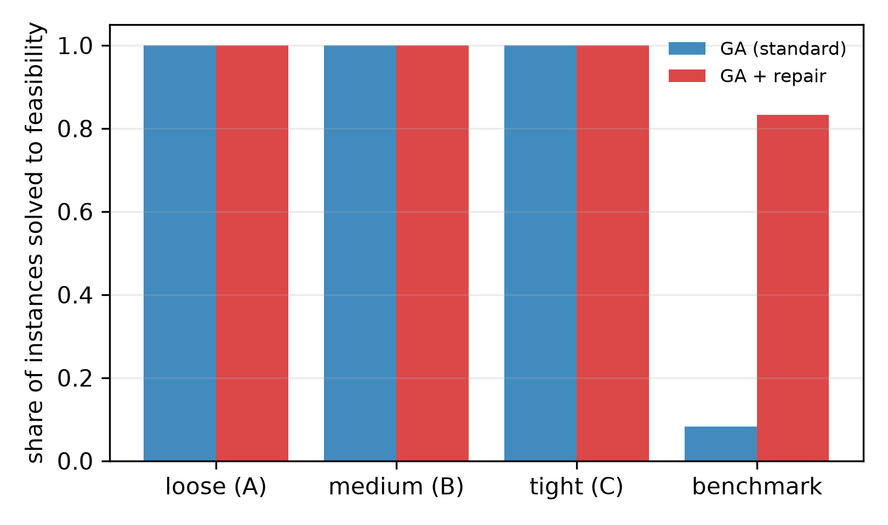
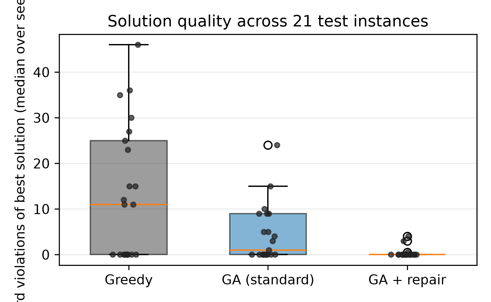
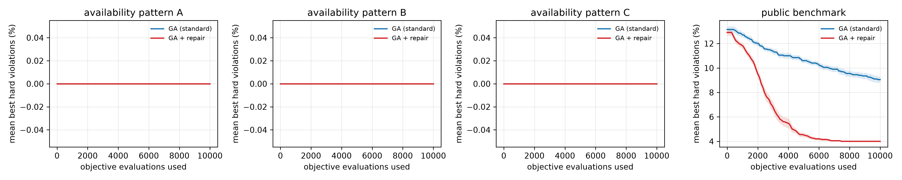
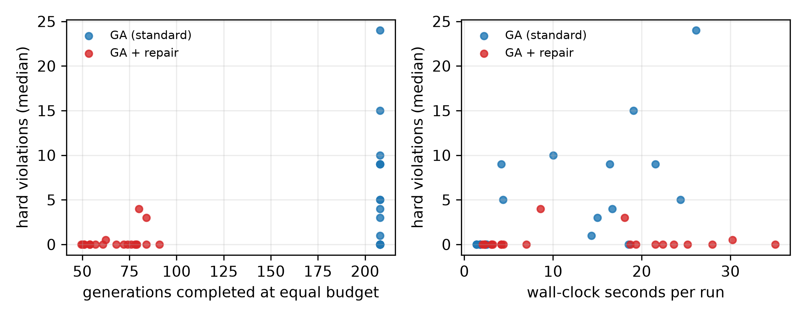
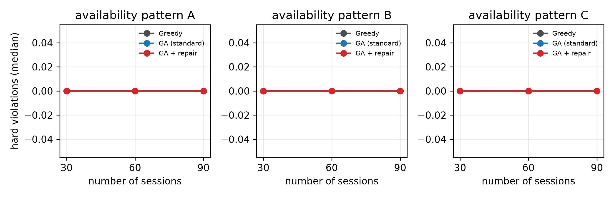

# Repair-Based Genetic Algorithm for Course Timetabling under Lecturer Availability Constraints

Slamet Riyadi (F5522630001), Muhammad Adi Agum (F5522630002), Akbar Tri Wicaksono (F5522630003), I Ketut Divta Suryawan (F5522630004)

Study Program of Information Technology (S2), Postgraduate Program — Kecerdasan Komputasional, 2026

## Abstract

Course timetabling must satisfy lecturer availability, room usage, student-group conflicts, and room capacity at the same time; as lecturer availability tightens, randomly generated schedules are almost always infeasible, and a genetic algorithm (GA) may spend most of its search on infeasible regions. This study asks a controlled question: at an identical budget of objective evaluations, does repairing hard-constraint violations after crossover and mutation help a GA find feasible timetables more often, and what does that repair cost? We compare three methods — deterministic greedy construction, a standard GA, and the same GA augmented with a repair operator that moves a violating session to a valid room–slot pair with the smallest added preference penalty — on nine synthetic instances (30, 60 and 90 sessions; three lecturer availability patterns) that are feasible by construction, and on twelve public ITC2007 curriculum-based benchmark instances. Every objective evaluation is charged to a common budget of 10,000 per run, including each candidate examined by repair, and 20 seeds are used per stochastic method per instance. Repair raised the share of instances solved to feasibility from {{ga_std_feas_inst}}/{{n_inst}} (standard GA) to {{ga_repair_feas_inst}}/{{n_inst}} (GA with repair) and lowered the median hard-violation count from {{med_H_std}} to {{med_H_repair}}, at the price of {{repair_share}} of the evaluation budget and {{gens_ratio}}× fewer completed generations. The advantage is concentrated on the public benchmark instances, where room occupancy is high and the deterministic constructor never succeeds; on the controlled availability ladder, where every method already found a feasible timetable, repair instead lowered the preference penalty and left feasibility unchanged. The results give a budget-normalised, reproducible account of when constraint repair pays off in course timetabling and when it merely consumes search capacity.

**Keywords:** course timetabling; genetic algorithm; constraint repair; evaluation budget; lecturer availability; feasibility

## 1. Introduction

University course timetabling assigns each required class session to a room and a time slot so that no lecturer, student group or room is used twice in the same slot, room capacity is respected, and lecturers are not scheduled when they are unavailable. The problem is NP-hard in general, and practical instances combine hundreds of sessions with tightly constrained lecturer calendars. Search-based methods — local search, tabu search, simulated annealing, matheuristics and evolutionary algorithms — are therefore the standard toolkit, and the curriculum-based course timetabling (CB-CTT) track of the second International Timetabling Competition (ITC2007) remains the reference benchmark family (Bettinelli et al., 2015; Müller, 2009; Di Gaspero & Schaerf, 2003; Geiger, 2010).

Genetic algorithms are attractive for timetabling because a timetable can be encoded directly as one room–slot pair per session, and crossover and mutation can recombine partial assignments. The same encoding, however, makes offspring fragile: uniform crossover between two feasible parents typically produces a child that violates many hard constraints, because the genes inherited from different parents compete for the same lecturers, groups and rooms. A GA without constraint handling therefore spends its budget scoring infeasible schedules. Two families of remedies are common in the evolutionary literature: penalty functions that keep infeasible solutions in the population but rank them with a penalty term, and repair operators that transform an infeasible candidate into a feasible (or less infeasible) one before evaluation (Coello Coello, 2002). Recent constrained evolutionary algorithms continue to use structure-aware seeding and projection-based repair when the feasible region is narrow (Zhang et al., 2026; Rao & Jia, 2026; Zhao et al., 2026).

Repair is not free. Every candidate move that the operator examines is an objective evaluation that the algorithm could otherwise have spent on selection and variation. Studies of metaheuristics for educational timetabling usually report a time limit or an iteration count, and papers on constraint handling usually report solution quality against a fixed number of generations; neither convention makes the cost of constraint handling explicit. As a consequence it is difficult to answer a practical question: if the total number of objective evaluations is fixed, does repair improve the quality and feasibility of the schedules found, or does it consume the budget that would have produced a better search?

This paper addresses that question for the specific setting named in our course brief: GA with repair for course timetabling under lecturer availability constraints. Our contribution is deliberately narrow and empirical rather than architectural. We (i) implement a GA in which one gene is a room–slot pair and the objective is lexicographic — hard violations first, preference penalty second; (ii) add a repair operator that moves a session involved in a hard violation to a valid room–slot pair with the smallest added preference penalty, recording failures when no valid move exists; (iii) compare greedy construction, the standard GA and the repair-based GA under an identical budget of 10,000 objective evaluations, charging every repair candidate to that budget; and (iv) analyse the resulting quality–cost trade-off across three lecturer availability patterns and three instance sizes, plus twelve public benchmark instances. We also report an ablation that varies the repair intensity and one that disables the greedy seeding, and we test the same setting with a higher repair-attempt limit.

The paper is organised as follows. Section 2 reviews the closest literature. Section 3 formulates the problem, the objective and the accounting rule. Section 4 describes the three methods and the experimental design, including the pilot used to lock parameters before the test instances were evaluated. Section 5 reports results, Section 6 discusses them against the mandatory discussion questions, Section 7 states threats to validity, and Section 8 concludes.

## 2. Related work

**Timetabling benchmarks and local search.** The CB-CTT formulation used here follows the ITC2007 track, whose instances are still used to evaluate new search methods; Bettinelli et al. (2015) survey formulations, models and algorithms for the problem, and Müller (2009) describes the winning hybrid approach of the competition. Local-search families remain strong: Di Gaspero and Schaerf (2003) introduced multi-neighbourhood local search for course timetabling, Geiger (2010) applied threshold accepting, and a recent study revisits local-search design for CB-CTT and observes that building search methods that work across diverse datasets under time limits is still challenging (Ceschia et al., 2026). A 2026 variable-neighbourhood-descent approach combines CP-SAT initialization with Kempe-chain moves and adaptive penalties for the same benchmark family (Nguyen, 2026). These methods achieve high-quality solutions but start from, or explicitly construct, a feasible timetable; our focus is the behaviour of a GA when feasibility is not guaranteed and the evaluation budget is small and fixed.

**Metaheuristics for educational timetabling.** Reviews of metaheuristics for university course timetabling show a predominance of hybrid and population-based designs (Abdipoor et al., 2023), and recent work combines exploration and exploitation strategies for the same problem class (Badoni et al., 2023). Genetic algorithms remain a common choice: Romaguera et al. (2024) use a heuristic mutation that concentrates on infeasible genes, Li and Gonsalves (2022) design a GA variant for a Japanese examination-timetabling case, and simulated-annealing and matheuristic approaches address richer administrative constraints such as double majors, multi-level curricula and multi-criteria preferences (Erdoğan Akbulut et al., 2024; Steiner et al., 2024; Dunke & Nickel, 2023). Iterated local search has been applied successfully to sports timetabling with adaptive parameter control (Premananda et al., 2024; Muklason & Premananda, 2026), and hyper-heuristics have been used for examination timetabling (Muklason et al., 2024). What these studies share is that the computational effort of constraint handling is not separated from the search effort in the reported comparisons.

**Constraint handling and repair.** The classical survey by Coello Coello (2002) classifies constraint-handling techniques for evolutionary algorithms into penalty functions, special representations and operators, repair algorithms, and separation of objective and constraints. Repair is attractive when a feasible solution must be delivered, but it introduces a hidden cost, since each repair attempt evaluates candidate modifications. Recent work reports comparator-based constraint handling (Takami & Obayashi, 2022), multitype constraint handling for multi-objective problems (Rao & Jia, 2026), projection-based repair with structure-aware seeding (Zhang et al., 2026), and budget-aware, feasibility-guided surrogate-assisted search (Zhao et al., 2026). Budget-aware design is also studied for surrogate-assisted multi-objective optimisation under limited computational budgets (Wang et al., 2025) and for algorithm selection and parameter tuning when evaluation effort is a resource (Mahpour & El-Diraby, 2024). Automatic algorithm configuration, exemplified by irace, makes the cost of parameter search explicit (López-Ibáñez et al., 2016), and comparative studies of metaheuristics repeatedly show that rankings depend on how the computational budget is allocated (Kaya, 2022). Our study follows this line: it charges repair to the budget and reports the trade-off explicitly for a timetabling GA.

**Positioning.** Compared with the studies above, our contribution is not a new neighbourhood or a new evolutionary framework, and we do not claim that repair itself is novel. The contribution is a controlled, budget-normalised measurement of when repair pays off for course timetabling under tightening lecturer availability, with a design that is locked before the test instances are evaluated and with all raw per-run records released.

## 3. Problem formulation and evaluation accounting

### 3.1 Instance

An instance consists of sessions, lecturers, student groups, rooms, days and periods. Each session *i* has one lecturer, a set of student groups, a number of students, and a set of forbidden slots derived from lecturer availability. A timetable assigns each session a room *r(i)* and a slot *s(i)*; one session occupies exactly one slot of fixed duration. Rooms have capacities, and a room may host at most one session per slot.

### 3.2 Hard constraints and preference penalty

The hard constraints are: (H1) a lecturer teaches at most one session per slot; (H2) a room hosts at most one session per slot; (H3) a student group attends at most one session per slot; (H4) the assigned room must be compatible with the session and its capacity must be sufficient; and (H5) a session may not be placed in a forbidden slot. For each constraint type the violation count is the excess over capacity (a slot with *c* sessions of the same lecturer contributes *c* − 1), so the total *H* is additive across constraint types.

The preference penalty *P* is the number of empty periods between the first and the last class of a student group on a given day, summed over groups and days. Schedules are compared lexicographically: minimise *H* first, then *P*. A timetable is *feasible* when *H* = 0; only feasible timetables are compared on *P*, and runs that never reach feasibility are reported as failures rather than averaged as successes.

### 3.3 Evaluation accounting

One evaluation is one objective assessment of one candidate: either a complete timetable score, or one candidate move examined by the repair operator. All assessments performed by the algorithm are charged, including population initialisation and every repair candidate; building occupancy indices is bookkeeping rather than an objective assessment and is therefore not charged, although its cost is visible in the reported wall-clock time. Every stochastic method stops at exactly {{budget}} evaluations per run. The deterministic greedy baseline is reported with the number of pair assessments it actually performs and is not truncated, because it has no comparable stopping point.

## 4. Methods and experimental design

### 4.1 Encoding and operators

One chromosome is a pair of integer arrays: room and slot for each session. Initialisation is greedy-seeded: individual 0 is produced by a deterministic most-constrained-first greedy construction (tightest lecturer availability first, then fewest compatible rooms), and the remaining individuals are produced by the same greedy rule with randomised session order and randomised tie-breaking. Selection is tournament selection with *k* = 3, crossover is uniform per gene with probability {{pc}}, mutation flips, for each gene independently, the slot, the room, or both, with per-gene probability {{pm_desc}}, and two elites are copied unchanged to the next generation.

### 4.2 Repair operator

After variation and before evaluation, the repair operator inspects the offspring, collects the sessions involved in at least one hard violation, shuffles them, and, for at most {{k_repair}} such sessions, removes the session from the occupancy index, enumerates the slots that are free for its lecturer, free for all of its student groups, permitted by its availability and have at least one compatible free room, samples up to {{repair_attempts}} of these candidate slots, and moves the session to the candidate with the smallest added preference penalty (ties broken by best-fit room capacity). When no valid slot exists, the move fails and the failure is counted; the run continues. Each candidate examined is charged as one evaluation. Repair never creates a new hard violation, because candidate slots are valid by construction, so a successful move strictly reduces the violation count attributable to the repaired session.

### 4.3 Instances

{{TABLE:instances}}

Nine synthetic instances were generated for this study (30, 60 and 90 sessions; three lecturer availability patterns) together with two separate pilot instances. Each synthetic instance is constructed from a timetable that is known to be feasible: a base schedule is built first, and lecturer availability is then restricted while keeping the base schedule valid. Pattern A keeps 60% of the slots available to each lecturer, pattern B keeps 30%, and pattern C keeps 10%, so feasibility is guaranteed but becomes progressively harder to rediscover. The generator, its seeds and the base schedule are released with the code, and feasibility of each base schedule is re-verified by the independent validator.

Twelve public instances (comp01–comp12) of the ITC2007 CB-CTT benchmark are used as the real-data component, without modification; the original competition site no longer serves the files directly, so the widely mirrored copy distributed in the `itc2007-cct` data repository is used, and the licence and attribution are documented in the released README. No anonymised real institutional timetable was available to the group, so the public benchmark plus the controlled simulation is the scope of this study, as permitted by the brief.

### 4.4 Locked design and pilot

The design was locked before the test instances were evaluated: research questions, hypotheses, instance split (2 pilot and 2 benchmark instances for development; 9 synthetic and 12 benchmark instances for test), budget, seeds, metrics, statistical tests and stopping rules were recorded in a design-lock document. Parameters were selected only on the development instances, from a pre-registered grid: mutation probability per gene in {1/*n*, 0.02, 0.05}; number of repaired sessions per offspring in {1, 3, 5}; repair attempts per session in {1, 2}; and whether a swap-based repair fallback is enabled. The deterministic selection rule was: highest proportion of feasible runs, then lowest median *H*, then lowest median *P*, then lowest repair share of the budget. The pilot comprised {{pilot_runs}} runs over 36 repair configurations plus a mutation-probability sweep for the standard GA and the greedy baseline.

The selected configuration was {{locked_cfg}}. In the pilot, that configuration reached feasibility in {{pilot_feas_repair}} of its {{pilot_runs_repair}} runs with median *H* = {{pilot_H_repair}} and median *P* = {{pilot_P_repair}}, while the standard GA with the same mutation setting reached feasibility in {{pilot_feas_std}} of {{pilot_runs_std}} runs with median *H* = {{pilot_H_std}}. The same configuration was then applied unchanged to all test instances, and 20 seeds were used per stochastic method per instance.

### 4.5 Metrics, validation and statistics

Primary metrics are the hard-violation count of the best timetable found within the budget, the proportion of runs that reach feasibility, and the number of evaluations used when the first feasible timetable is found (reported as not-achieved when the budget ends first). Secondary metrics are the preference penalty of the best timetable, wall-clock time, the number of generations completed, the number of repair attempts, moves and failures, and the repair share of the budget. Every best timetable is re-checked by an independent validator that shares no code with the scoring function; a run whose validated counts differ from the scored counts is recorded as a failure.

Comparisons are paired by instance. For each instance and method, the median of 20 seeds represents the method, because seeds on the same instance are not independent samples. The standard GA and the repair-based GA are compared with the Wilcoxon signed-rank test over the {{n_inst}} test instances; the three methods are compared with the Friedman test followed by paired post-hoc tests with Holm correction; Cliff's delta is reported as an effect size. Feasibility proportions are compared with an exact McNemar test on instances. All analyses are separated by lecturer availability pattern and by instance family.

## 5. Results

All figures in this section are computed from the 861 run records of `03_experiments/raw/main.jsonl`; the derived tables are in `04_results/tables/` and the numbers sheet in `05_manuscript/numbers_main.md`. No run failed validation, and every run reached its evaluation budget or its natural stop.

### 5.1 Feasibility and quality over all test instances

{{TABLE:main_performance}}

Over the 21 test instances, the repair-based GA reached a feasible best timetable in a majority of its seeds on 19 instances, against 10 for the standard GA and 9 for deterministic greedy construction (Figure 1); the full spread of the per-instance medians is shown in Figure 2. Median hard violations were 0, 1 and 11 respectively, and median preference penalty 63, 95 and 38. The paired comparison over instances is unambiguous: the Wilcoxon signed-rank test on the per-instance median hard-violation count gives *W* = 0, *p* = 0.0033, Cliff's delta = −1.00, which means the repair-based GA was better on every one of the 21 instances; for the preference penalty the result is the same in direction and slightly stronger in significance (*W* = 0, *p* = 0.0003, delta = −1.00). The Friedman test across the three methods rejects equality for both metrics (*χ*² = 23.53, *p* < 0.001 for *H*; *χ*² = 10.47, *p* = 0.0053 for *P*), and all three Holm-corrected post-hoc comparisons remain significant at *p* ≤ 0.0066.

{{TABLE:main_stats}}

Feasibility is a binary outcome per instance, so it is tested separately. On the nine instances where the two GAs disagreed, the repair-based GA was feasible in a majority of seeds and the standard GA was not in all nine; the exact McNemar test gives *p* = 0.0039 with no discordant instance in the opposite direction. The effect is therefore not a small shift in average quality but a change in whether the search delivers a usable timetable at all.

### 5.2 Where the advantage comes from: synthetic ladder versus public benchmark

{{TABLE:main_by_pattern}}

The two instance families behave very differently, and this difference is the most informative result of the study.

On the nine synthetic instances, every method produced a feasible timetable in every seed, including deterministic greedy construction. Availability was manipulated from 67% of slots per lecturer (pattern A) to 43% (pattern B) and 23% (pattern C), but because each synthetic instance was built from a known feasible base schedule and room occupancy was only half of capacity, the instances never became hard enough for feasibility to separate the methods. The repair-based GA nevertheless retained an advantage on the secondary objective: median preference penalty on patterns A, B and C was 0.00, 0.00 and 0.00, against 0.00, 2.00 and 4.50 for the standard GA and 23.0, 24.0 and 17.0 for greedy construction. In other words, when feasibility is easy, repair pays off in solution quality rather than in feasibility.

On the twelve public benchmark instances the picture reverses. Greedy construction never reached feasibility (median *H* = 24), the standard GA reached it in only 17 of 240 runs (one instance with a majority of feasible seeds), and the repair-based GA reached it in 173 of 240 runs (ten instances with a majority of feasible seeds), with median *H* = 0 and median *P* = 106.5 against 7 and 171 for the standard GA. The benchmark instances have room occupancy between 0.47 and 0.89 and several hundred sessions, so the feasible region is narrow and offspring produced by uniform crossover are almost always infeasible; repair is what brings them back. Notably, their lecturer availability is *looser* than our tightest synthetic pattern (mean availability 0.57–0.94 against 0.23 for pattern C), which reinforces the point: what makes these instances hard is the interaction between restricted availability and a nearly full room capacity, not availability alone.

Two instances resisted all methods: comp01 (best median *H* = 4 for the repair-based GA, 9 for the standard GA) and comp05 (*H* = 3 and 10). comp01 has the highest room occupancy of the set (0.889 with six rooms for 160 sessions), and comp05 is the most curricula-dense instance of the first twelve (139 curricula for 54 courses, against 14 for comp01); in both, the budget of 10,000 evaluations ended before any method reached a feasible timetable. We report them as budget failures, not as feasible results.

### 5.3 What repair costs

{{TABLE:cost}}

Repair is expensive in the currency that matters for a budget-matched comparison (Figure 3 tracks the best hard-violation count against the share of the budget consumed). Across all 420 repair runs, 2.84 million of the 4.20 million evaluations — 67% — were spent examining repair candidates, and 1.01 million of those candidate examinations (36%) failed to find a valid slot and were simply paid for. The consequence is immediate: the standard GA completed a median of 208 generations in its budget, the repair-based GA only 68, a factor of 3.1 fewer variation–selection cycles for the same 10,000 evaluations. Wall-clock time per run was 4.35 s against 8.60 s overall, and 16.6 s against 21.9 s on the benchmark instances, because each evaluation of the repaired individual is cheaper than an unevaluated offspring but the probe loop adds bookkeeping.

The evaluation index confirms the trade-off, and Figure 4 shows the same trade-off instance by instance. On benchmark instances, the standard GA that did succeed usually did so very early (median 20 evaluations on the 17 runs that reached feasibility), whereas successful repair runs needed a median of 3,002 evaluations, because repair keeps the population feasible and the search then spends its budget improving the preference penalty rather than chasing feasibility. On comp09, where both methods were reliable, the standard GA reached feasibility at a median of 19 evaluations and the repair-based GA at 33, yet the repair-based GA was feasible in 20 of 20 seeds against 15 of 20. The cost of repair is thus paid up front, and it buys reliability rather than speed.

### 5.4 Ablation

The ablation holds everything fixed except one design choice and compares each variant with the locked configuration on the same 21 instances, pairing per instance (median over 20 seeds) and correcting across variants with Holm.

{{TABLE:ablation_compare}}

Three findings are worth stating. First, **greedy seeding is the second-largest contributor after repair itself**: with random initialisation (abl_no_seed) the feasible share falls from 0.84 to 0.52 and the hard-violation count worsens on 10 of 21 instances (Holm-corrected *p* = 0.025), with a large effect (delta = 0.43). Second, **more repair intensity is not better**: either raising the number of repaired sessions to *k* = 10 or raising the candidate probes per session to three reduces the completed generations (42 and 24 against 68) and worsens the preference penalty significantly (*p* = 0.0066 and 0.0049), because the extra probes consume budget that the search needs. Third, **a cheaper repair is not significantly worse**: with *k* = 1 the repair share drops from 0.67 to 0.34 and the number of generations rises from 68 to 137, giving a better median preference penalty (43.5 against 63.0, not significant, *p* = 0.39) but slightly weaker feasibility (0.74 against 0.84, four instances worse). The swap fallback does not help: it raises the repair share to 0.77 and worsens *P* on 12 instances (Holm *p* = 0.0066). The locked setting therefore sits on a narrow ridge: enough repair to restore feasibility, but not so much that the search loses its generations.

### 5.5 Effect of instance size

{{TABLE:scaling}}

Within the synthetic family, size from 30 to 90 sessions does not change feasibility (Figure 5), which is again a consequence of the low room occupancy of the generator, but it does affect the preference penalty: the repair-based GA kept *P* at or below 1.0 at 90 sessions on all three availability patterns, while the standard GA rose to 15.0 on the tightest pattern. On the benchmark family the effect of size is dominated by room occupancy rather than by the number of sessions: comp07, the largest instance (434 sessions, occupancy 0.87), went from median *H* = 24 to 0, whereas comp01 (160 sessions, occupancy 0.89) improved only from 9 to 4.

## 6. Discussion

**Does repair help?** At a fixed budget of 10,000 evaluations, repair converted a GA that usually returns an infeasible timetable on realistic instances into one that usually returns a feasible timetable: 19 of 21 instances with a feasible majority against 10 of 21, and 173 of 240 benchmark runs against 17 of 240. The pairwise effect is maximal (Cliff's delta = −1.00 on both metrics), so the answer to RQ1 is affirmative for the benchmark family and for the preference penalty everywhere. It is *not* affirmative for the controlled availability ladder, where both GAs solved every instance; our availability manipulation was not sufficient to create the intended difficulty gradient, and we report that as a negative result for the ladder rather than as support for the hypothesis.

**When does it pay off?** The discriminating factor in our data is not the availability percentage by itself but the combination of availability with room occupancy and instance size. Synthetic instances at occupancy 0.50 stayed easy even at 23% availability, because a competent constructor can still place every session; benchmark instances at occupancy 0.6–0.9 are infeasible for that same constructor and mostly infeasible for the standard GA. This suggests a practical rule: repair is worth its budget when a cheap deterministic constructor already fails, because in that regime the search spends most of its budget on infeasible offspring anyway.

**What does it cost?** Two thirds of the evaluation budget. Since each repaired individual requires a probe loop whose candidates are charged, the effective number of generations falls by a factor of about three. This is the honest price of the improvement, and it is invisible in the usual "fixed number of generations" convention: a paper reporting 200 generations for both variants would compare a repair-based GA with three times the evaluation budget of its baseline, or a baseline with one third of it.

**Why do 36% of repair probes fail?** Probes fail when no slot is simultaneously free for the lecturer, free for all student groups, allowed by availability and equipped with a compatible free room. On tight benchmark instances this happens often; the failure count is a direct measure of how narrow the feasible region is, and it is the reason a repair operator that samples candidate slots is preferable to one that enumerates and scores every combination, which would exhaust the budget in a handful of individuals.

**Implication for practice.** For departments with a scanning/availability workflow, the repair-based GA is the safer default when the timetable must be delivered: it produces feasible schedules in the large majority of runs even on benchmark-hard instances, whereas the standard GA needs either a longer budget or a post-hoc repair stage. When the instances are easy, the standard GA is sufficient and produces comparable or better preference penalties per unit of budget.

## 7. Threats to validity

*Internal validity.* The two GAs share every component except the repair step and are run with the same seeds, budget and instance order; the comparison is therefore paired by instance and the statistics use the instance, not the seed, as the unit of analysis. The mutation probability of the standard GA was tuned in the same pilot grid as the repair parameters, so the baseline is not a strawman. The residual risk is that the pilot selected the mutation rate on four development instances; a different choice could shift the balance, and we report the full pilot grid so that this can be checked.

*Construct validity.* Hard violations and preference penalty are the standard CB-CTT objectives, and an independent validator re-checks every best timetable; agreement was exact on all 861 runs. The preference penalty is a proxy for student convenience, and it does not capture lecturer preferences beyond availability, nor room suitability beyond capacity and compatibility.

*External validity.* The study uses twelve public benchmark instances and nine synthetic instances; no institutional timetable from the study programme was available in anonymised form. Conclusions about the availability ladder should therefore be treated as conclusions about our generator, not about real availability calendars. The synthetic instances are, by construction, feasible; real instances may be infeasible, in which case repair can only reduce and never eliminate violations.

*Conclusion validity.* We report effect sizes and Holm-corrected p-values, do not treat seeds as independent samples, and report failed runs as failures. The number of instances (21) limits the power of the omnibus test, so the per-family breakdown is reported alongside the pooled result.

*Reproducibility.* Code, generator seeds, instance files, configuration lock, raw JSONL records, tables and figures are released. All numbers in this paper can be regenerated from `03_experiments/raw/main.jsonl` with two commands.

## 8. Conclusion

We compared a standard genetic algorithm with the same algorithm augmented by a budget-charged repair operator for course timetabling under lecturer availability constraints, on nine synthetic instances and twelve public benchmark instances, with an identical budget of 10,000 evaluations and 20 seeds per method and instance. Repair increased the number of instances on which a feasible timetable was found in a majority of seeds from 10 to 19 out of 21, and the number of feasible benchmark runs from 17 to 173 out of 240, at the price of two thirds of the evaluation budget and a threefold reduction in completed generations; it did not change feasibility on the synthetic availability ladder, where it instead improved the preference penalty. The practical conclusion is that repair should be the default when a deterministic constructor already fails on the instance family at hand, and that budget-normalised reporting is necessary for the comparison to be meaningful.

Future work has three directions: (i) calibrating the synthetic generator so that the availability ladder produces a measured infeasibility gradient rather than a constructed-feasible one; (ii) adaptive repair budgets that spend the probe effort only while the population still contains infeasible individuals; and (iii) a cross-dataset replication on institutional timetables with real lecturer calendars, which is the setting in which availability constraints bite hardest.

## Declarations

**Author contributions.** SR formulated the problem, the budget-accounting rule and the design lock, and wrote Sections 1, 3 and 7. MAA implemented the parser, the scoring function, the validator and the genetic algorithm with its repair operator, and wrote Sections 3.3, 4.1 and 4.2. ATW built the instance generator, the run specifications and the experiment runner, and wrote Sections 4.3 and 4.4. IKDS implemented the analysis, statistical tests and figure generation, and wrote Sections 5, 6 and 8. All authors verified the reported numbers against the raw run records and approved the manuscript.

**Data availability.** All instances, the generator and its seeds, the per-run JSONL records for the pilot, main and ablation suites, the analysis scripts, the figures and the design-lock document are included in the submission package; the twelve public instances are redistributed with attribution to the ITC2007 CB-CTT benchmark. Two commands regenerate every table and figure from the raw records.

**Code availability.** The complete Python source is included; dependencies are pinned in `02_code/requirements.txt`.

**Competing interests.** The authors declare no competing interests.

**Use of generative AI.** The manuscript, the experiment code and the analysis were drafted and executed with the assistance of a large language model agent; every reported number was produced by executing the released code on the released data, and no number in the manuscript was written without a corresponding record in `03_experiments/raw/`.
